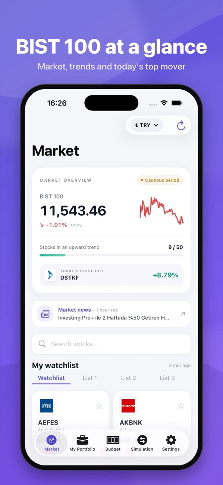
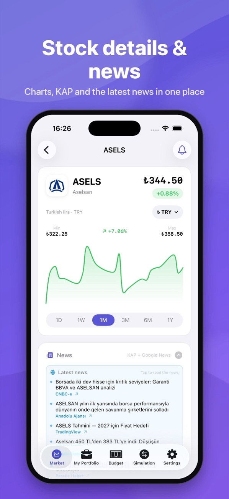
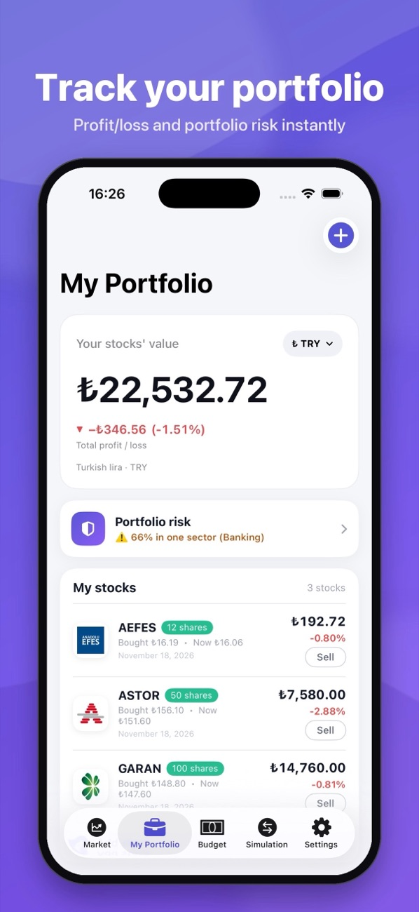
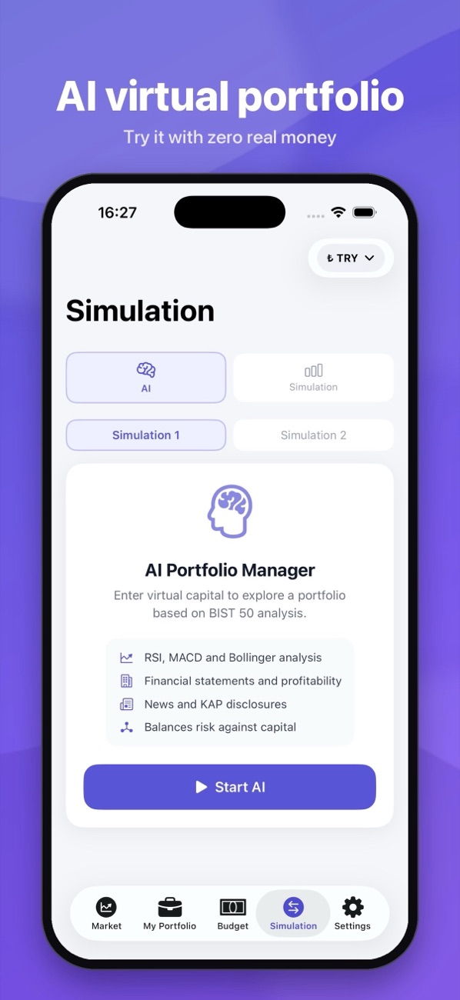
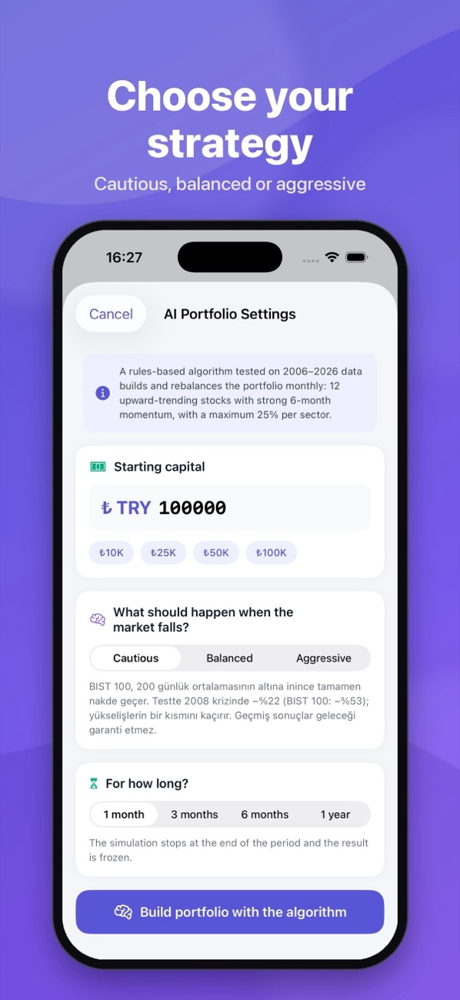
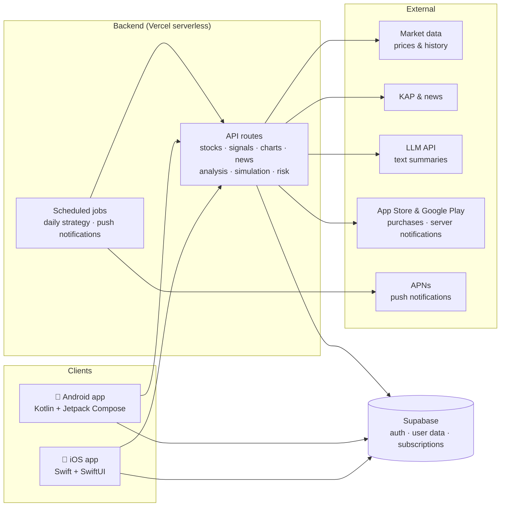

  

<h1 align="center">BISTAsistan</h1>

  <b>A simple, data-driven assistant for the Borsa Istanbul stock market.</b> 
  Native iOS and Android apps to follow the BIST 100, track a portfolio, measure its risk and test a rules-based strategy with virtual money.

  
  
  
  

> **Note:** BISTAsistan is a commercial product, so its source code is private. This repository presents the project: what it does, how it is built, and what I learned. A detailed technical overview is available as a PDF: **[docs/bistasistan-overview.pdf](docs/bistasistan-overview.pdf)**.

---

## Screenshots

  
  
  
  
  

---

## The problem

Many new investors in Türkiye start trading on Borsa Istanbul without tools to understand what they buy. Prices, technical indicators, company announcements (KAP) and news are spread across many websites, and portfolio risk (for example, holding only banks) is rarely visible.

## The solution

BISTAsistan brings everything into one simple app:

- **Market at a glance**: BIST 100, market trend, top movers and news
- **Stock details**: charts from 1 day to 1 year, KAP announcements, news, and simple summaries of RSI, MACD and Bollinger Bands
- **Portfolio tracking**: value, profit and loss, sales history, and **portfolio risk** (sector concentration, volatility, drawdown scenarios)
- **Virtual portfolio simulation**: test a **rules-based algorithm** with virtual money, with no real trades
- **Budget analysis** and **notifications**: morning market summary, big market moves and price alerts

> ⚠️ BISTAsistan is an information and education app. It does not give investment advice.

---

## Features

| | Feature | Details |
|---|---|---|
| 📈 | **Market overview** | BIST 100 index, daily change, share of stocks in an upward trend, today's highlight, news |
| ⭐ | **Watchlists** | Four separate lists of followed stocks |
| 🔎 | **Stock details** | 1D–1Y charts, KAP announcements, Google News, technical indicators in plain language |
| 🔔 | **Price alerts** | Push notification when a stock reaches a chosen price |
| 💼 | **My Portfolio** | Holdings, live value, profit/loss, sales history, multi-currency display |
| 🛡️ | **Portfolio risk** | Sector concentration, volatility and possible drawdown scenarios |
| 🤖 | **AI virtual portfolio** | Rules-based strategy (cautious, balanced or aggressive) rebalanced monthly, with virtual capital |
| 🧪 | **Manual simulation** | Make your own virtual trades |
| 💰 | **Budget analysis** | Summary based on the user's budget and portfolio |
| 🌍 | **5 languages** | Turkish, English, French, Spanish, German |
| ⭐ | **Premium** | Monthly, 6-month and yearly plans with a 3-day free trial (Apple and Google in-app purchases) |

---

## Architecture

- **Two native apps, one backend**: the iOS and Android apps share the same API and the same user accounts.
- **Numbers come from code, not from the AI.** Indicators (RSI, MACD, moving averages, Bollinger Bands), risk and the strategy are computed by deterministic code. The language model only writes short, readable summaries.
- **Server-side purchase verification** for both Apple and Google, and App Store server notifications to keep subscriptions up to date.

## Tech stack

| Layer | Technologies |
|---|---|
| iOS | Swift, SwiftUI, iOS 17+, StoreKit, APNs |
| Android | Kotlin, Jetpack Compose, Google Play Billing, WorkManager, Android 8+ |
| Backend | Node.js serverless functions on Vercel (Node and Edge runtimes), scheduled jobs |
| Database & auth | Supabase (PostgreSQL), Sign in with Google and e-mail |
| Research | Python backtesting scripts on daily price history |

---

## The strategy, and how I tested it

The virtual portfolio uses a **momentum strategy** that I designed and backtested in Python:

- every month, keep the **12 BIST stocks with the strongest 6-month momentum** (skipping the most recent month), only if their price is above the 200-day moving average;
- penalise very volatile stocks, and limit any sector to **25%** of the portfolio;
- the *cautious* mode moves to cash when the BIST 100 falls below its 200-day average.

To avoid overfitting, I tuned the parameters on one period and evaluated them on a **later, separate period**, and I checked that most of the ~200 parameter combinations gave similar results. I also documented the limits of the test (survivorship bias in today's stock list, returns in nominal Turkish lira). Details are in the PDF.

---

## What I learned

- Building and shipping **two native apps** (Swift and Kotlin) for the same product, on the App Store and Google Play
- Designing a **serverless backend** with scheduled jobs, push notifications and several external data sources
- **Quantitative research**: backtesting, train/test splits, robustness checks and honest reporting of limitations
- Making technical finance concepts (RSI, MACD, risk) **understandable for beginners**
- **Subscriptions** on both stores, with server-side verification
- Store rules for finance apps: clear disclaimers, no investment advice

---

  Designed, built and published by <b>Görkem Özbek</b> 
  <a href="https://apps.apple.com/tr/app/bistasistan/id6797870700">App Store</a>

